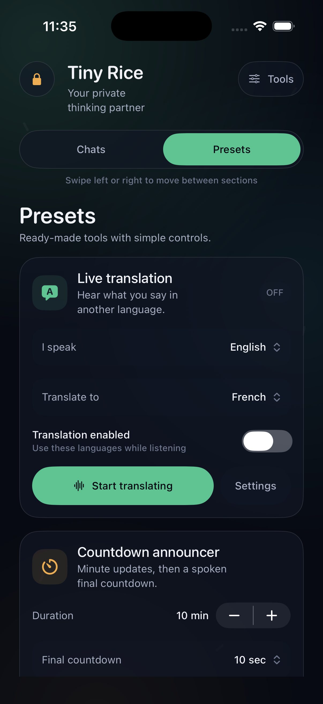
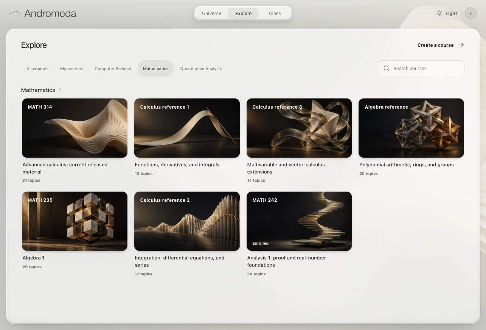
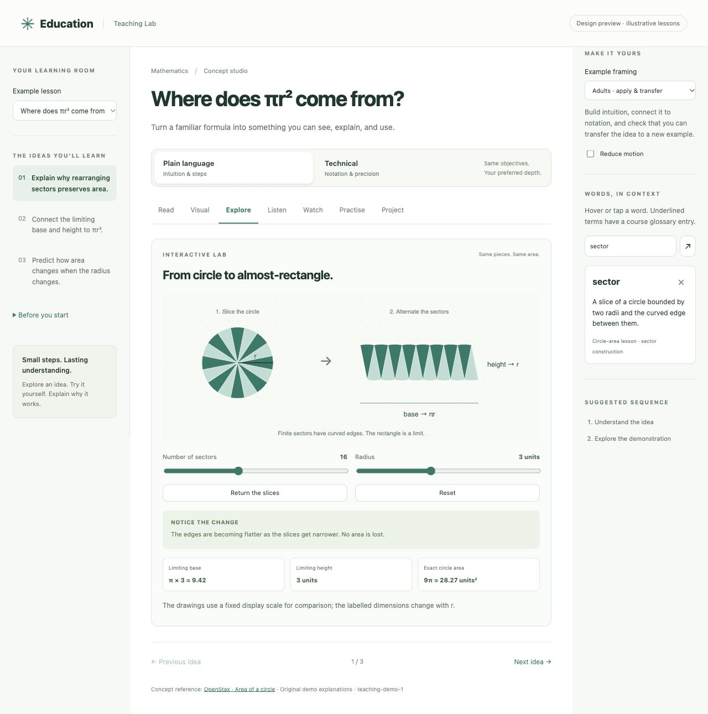
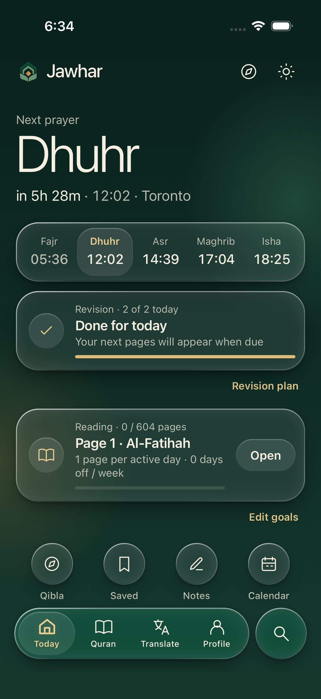
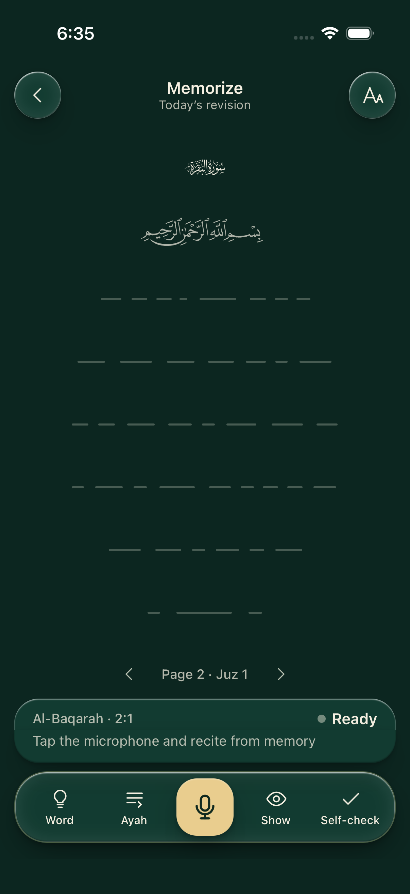
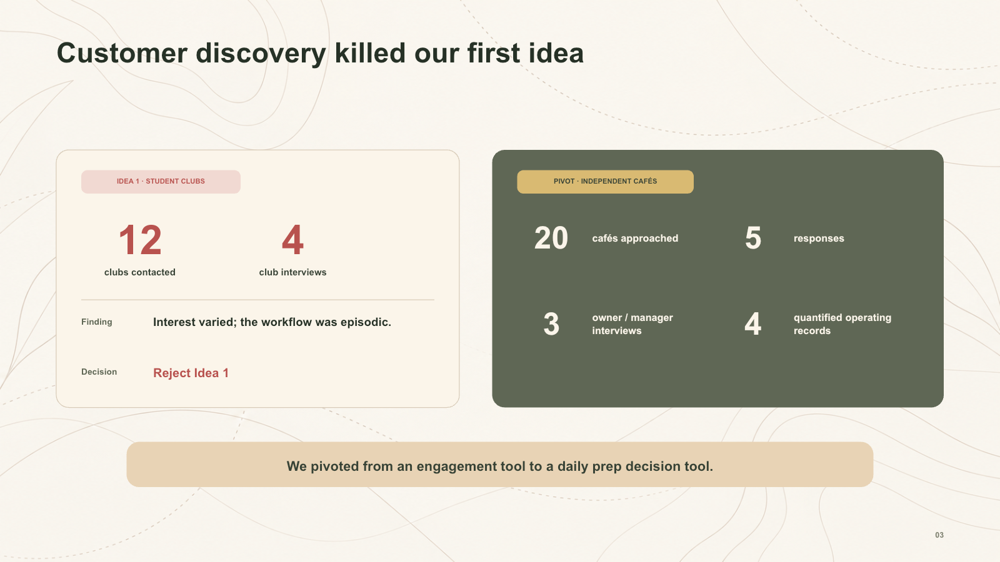

# Omar Talaat

Statistics & Computer Science at McGill. Montreal and the UAE.

I build products and do some quantitative research. Most of the code is private, so this page is mostly screenshots and short notes.

[LinkedIn](https://www.linkedin.com/in/omar-talaat-701a90430/) · [Email](mailto:omar.talaat@omartalaat.com)

---

### Tiny Rice

A private iOS assistant built to work with wearables. It's a SwiftUI app, a TypeScript API, firmware for an ESP32-S3 camera, and an integration with Even G2 smart glasses. Still in development.

### Andromeda

A learning app for technical subjects. Each idea gets a short explanation, an interactive lab to play with, and practice, and every course maps onto one shared concept graph so the same idea isn't taught twice. One React/TypeScript codebase for web, desktop (Tauri) and mobile (Capacitor).

### Jawhar

An offline-first Quran reader and memorization app built with Expo and React Native. It has the full 604-page mushaf, search, daily reading plans, spaced revision, prayer times and qibla. Accepted into McGill's Dobson Lean Startup Program.

 

Simulator captures from an unreleased build.

### FreshShift · Winner, DobsonHacks Venture Challenge 2026

Four-person team. It tells independent cafés how much to prep for tomorrow, using their sales history plus weather and local events, and the manager can adjust the number. Talking to customers killed our first idea, which is the slide below.

### FIAM equity strategy · McGill–FIAM 2026

Five-person quant research submission. I handled integration, the chronological backtest and the experiment comparison on a 529k-row U.S. equity panel over 68 out-of-sample months. Most of the ML models we tried didn't get past our validation gates, so we kept a SCAD/Ridge portfolio.

### APEX 7

A Python engine for testing systematic-trading ideas. The same code runs historical backtests and demo-account trading, with trading costs, held-out periods and randomized controls built in. Nothing in it is profitable enough to fund yet.

### OptiFrame · Top 5, CodeML 2026

Team project. It goes from a photo of a lens to a measured contour, a 3D frame preview and a printable STL for a fit test.

### Stay22 expansion case · 1st place, Retail Innovation Challenge

Team consulting case on where Stay22 should expand next.

### Coral Stash · 2023–2025

A saltwater-aquarium store I started and ran on Shopify in the UAE before university. It did 200 orders and AED 113,650 in gross sales.

---

Open to summer 2027 internships in applied AI, quant, product or fintech, in the UAE or Montreal.
